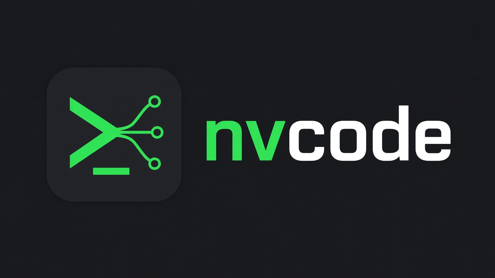
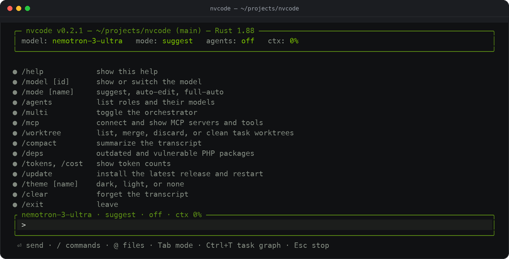
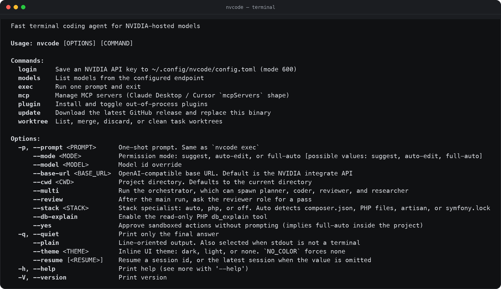

<p align="center">
  
</p>

<p align="center">
  <a href="https://gitlab.com/mrokonuzzaman040/nvcode/-/releases/permalink/latest"></a>
  
  
</p>

nvcode is a terminal coding agent for NVIDIA's OpenAI-compatible API
([integrate.api.nvidia.com](https://integrate.api.nvidia.com/v1)). One Rust
binary: a streaming agent loop, exact file edits, a multi-agent orchestrator,
an MCP client, and out-of-process plugins.

It stays light. A current-thread Tokio runtime, an inline terminal UI that
keeps the conversation in normal scrollback instead of taking over the screen,
and an HTTP client built on the first model request, so an idle session never
loads TLS. `nvcode --help` returns in about a millisecond, and an idle inline
session sits near 5 MB of RSS.



## Install

Linux and macOS:

```sh
curl --proto '=https' --tlsv1.2 -fsSL https://gitlab.com/mrokonuzzaman040/nvcode/-/releases/permalink/latest/downloads/install.sh | sh
```

Windows (PowerShell):

```powershell
irm https://gitlab.com/mrokonuzzaman040/nvcode/-/releases/permalink/latest/downloads/install.ps1 | iex
```

Both scripts pick the archive for this machine, verify it against
`SHA256SUMS`, and copy `nvcode` onto `PATH`. `PREFIX` sets the install prefix
(`/usr/local` when that `bin` directory is writable, otherwise `~/.local` on
Unix and `%LOCALAPPDATA%\nvcode` on Windows). `NVCODE_MUSL=1` forces the static
x86_64 musl build, which is what Alpine and other musl systems want.

Packages, installers, and the Homebrew formula are attached to every
[release](https://gitlab.com/mrokonuzzaman040/nvcode/-/releases). See
[docs/INSTALL.md](docs/INSTALL.md) for the `.pkg`, `.msi`, `.deb`, `.rpm`,
AppImage, and Homebrew routes, with verification and uninstall notes.

## First run

Get a free catalog key at [build.nvidia.com](https://build.nvidia.com/), then:

```sh
export NVIDIA_API_KEY=nvapi-...
# or
nvcode login
```

`nvcode login` writes `~/.config/nvcode/config.toml` with mode `600`.
`nvcode --version` needs no key; a key is only used when you call a model.

## Quick start

```sh
nvcode                          # inline REPL on a TTY
nvcode -p "Add a test for parse"
nvcode exec "List the Rust files"
nvcode --multi -p "Plan, edit, and review the change"
nvcode --plain                  # line-oriented REPL
nvcode --theme light            # dark (default), light, or none
nvcode models                   # endpoint models and capabilities
nvcode models --probe           # one tiny tool call per model, cached
nvcode --resume                 # latest session
nvcode update --check           # latest release
```

One-shot mode never prompts. Pass `--yes` or `--mode full-auto` when the task
needs writes or shell.

## What you get

`nvcode` runs a tool loop against the model with `read_file`, `write_file`,
`edit_file`, `list_dir`, `glob`, `grep`, `run_shell`, `todo_write`, plus any
MCP tools you connect.

- **Exact edits.** `edit_file` replaces an `old_string` it has to match
  exactly, shows the diff first, writes atomically, and reads the file back. A
  missing or ambiguous match is an error, not a partial write.
- **A jailed project root.** Paths are normalized and the existing parent is
  canonicalized, so `..` and symlinks cannot escape the project. `run_shell`
  starts `sh -lc` with the working directory pinned to the root and a timeout.
- **Multi-agent mode.** The orchestrator plans a DAG of planner, coder,
  reviewer, researcher, and specialist roles. Ready tasks run at the same time,
  each in its own git worktree, and dependent tasks see upstream summaries,
  changed files, and a shared blackboard. The inline UI draws a live task graph
  (Ctrl+T).
- **Isolated worktrees.** Each task gets `.nvcode/worktrees/<id>` on branch
  `nvcode/<id>`, merged back once verification passes. Composer and pnpm stores
  and the PHP analysis tools are shared through the nvcode cache, so parallel
  worktrees do not re-download the world.
- **A PHP specialist** that turns itself on for `composer.json`, `*.php`,
  `artisan`, or `symfony.lock` projects: framework and runtime detection,
  PSR-12 and modern-syntax rules, an OWASP Top 10 review pass, `db_explain`,
  `/deps`, and a production-readiness checklist before a task is called done.
- **MCP and plugins.** stdio, Streamable HTTP, and legacy HTTP+SSE servers,
  with resources and prompts. Plugins stay out of process: prompt templates,
  instruction files, hook commands, roles, and MCP server entries.
- **Self-update.** Sessions check releases in the background on startup and
  print `nvcode vX.Y.Z is available — run /update to install`. `/update` and
  `nvcode update` verify `SHA256SUMS`, replace the binary, and restart.

## Permission modes

| Mode | Writes in the project | Shell and side-effect MCP |
| --- | --- | --- |
| `suggest` (default) | ask | ask |
| `auto-edit` | allow | ask |
| `full-auto` | allow | allow |

Reads inside the project are always allowed. In a non-interactive run, an
"ask" becomes a deny. Tab and Shift+Tab cycle modes in the REPL.

## Inline UI

Finished lines stay in scrollback and the input sits at the bottom, so the
mouse wheel and your terminal's own search keep working. Assistant text
streams as markdown with a small keyword highlighter, tool rows collapse to
`▸ $ cmd` with an exit status and duration, and edits show a coloured unified
diff before they are applied.

| Key | Action |
| --- | --- |
| Enter | Send |
| Shift+Enter, Alt+Enter | New line |
| Up / Down | History, or move inside a multi-line draft |
| `@` | Fuzzy file mention (respects `.gitignore`) |
| `/` | Slash commands, including plugin and MCP tools |
| Tab / Shift+Tab | Cycle approval mode |
| Ctrl+T | Show or hide the task graph |
| Ctrl+O | Expand or collapse the latest tool output or diff |
| Esc | Interrupt the current generation, or deny a pending approval |
| Ctrl+C, Ctrl+C | Exit (press twice) |

Slash commands: `/help` `/model` `/mode` `/agents` `/multi` `/mcp`
`/worktree` `/compact` `/deps` `/tokens` `/cost` `/update` `/theme` `/clear`
`/exit`.

Project instructions load from `NVCODE.md`, `AGENTS.md`, and
`.nvcode/instructions.md`. Sessions are JSON files in
`~/.config/nvcode/sessions` and prompt history is
`~/.config/nvcode/history.json`, both mode `600`.



## Models

Default roles use NVIDIA-hosted models, picked by live `edit_file` probes:

| Role | Model |
| --- | --- |
| orchestrator, planner, coder | `nvidia/nemotron-3-ultra-550b-a55b` |
| reviewer, php-security-reviewer, db-optimizer | `minimaxai/minimax-m3.1-flash` |
| researcher | `nvidia/nemotron-3.5-lightning-30b-a3b` |
| complexity assessor, `/compact` | `nvidia/nemotron-3.5-bolt-e4b` |

The reviewer is a different family so it is not the coder grading itself. If a
role model returns 404, 410, or 503, or stays silent past
`first_token_timeout_secs`, nvcode moves to the next id in that role's chain
and prints one line: `switched coder from <old> to <new> (410)`.

`nvcode models` lists the endpoint with context, output, tool, reasoning, and
vision capabilities. `nvcode models --probe` verifies tools with one tiny call
per model and caches the marks in `~/.cache/nvcode/model-probe.json`.

## Configuration

Load order:

1. Built-in defaults
2. `~/.config/nvcode/config.toml` (`$XDG_CONFIG_HOME/nvcode/config.toml`)
3. The nearest `.nvcode/config.toml`, walking up from the working directory
4. Environment: `NVIDIA_API_KEY`, `NVCODE_BASE_URL`, `NVCODE_MODEL`,
   `NVCODE_MODE`, `NVCODE_MULTI_AGENT`, `NVCODE_MAX_PARALLEL`, `NVCODE_STACK`,
   `NVCODE_FIRST_TOKEN_TIMEOUT`, `NVCODE_NO_UPDATE_CHECK`
5. Flags: `--base-url`, `--model`, `--mode`, `--yes`, `--review`, `--cwd`,
   `--plain`, `--theme`, `--multi`, `--stack`, `--db-explain`

A project file cannot set the API key.

```toml
default_model = "nvidia/nemotron-3-ultra-550b-a55b"
permission_mode = "suggest"
context_window = 32768
multi_agent = "auto"      # auto | always | never
max_parallel_agents = 4
worktrees = true
stack = "auto"            # auto | php | off

[models]
reviewer = "minimaxai/minimax-m3.1-flash"

[php]
db_explain = false
verify_retries = 3
```

## Keeping up

`nvcode update` downloads the archive for this OS and architecture, checks it
against `SHA256SUMS`, replaces the running binary, prints the release notes,
and restarts. `nvcode update --check` only reports the latest version. When the
install directory is not writable it says so and prints the
`sudo nvcode update` or installer command instead of half-installing.

Archive names are stable so scripts can pin them:

| Asset | Machine |
| --- | --- |
| `nvcode-x86_64-unknown-linux-gnu.tar.gz` | Linux x86_64 (glibc) |
| `nvcode-aarch64-unknown-linux-gnu.tar.gz` | Linux arm64 |
| `nvcode-x86_64-unknown-linux-musl.tar.gz` | Alpine and other musl systems |
| `nvcode-x86_64-apple-darwin.tar.gz` | Intel Mac |
| `nvcode-aarch64-apple-darwin.tar.gz` | Apple silicon Mac |
| `nvcode-x86_64-pc-windows-msvc.zip` | Windows x64 |
| `SHA256SUMS`, `install.sh`, `install.ps1` | checksums and installers |

Packaged installers carry the version in the file name, for example
`nvcode-0.2.2-universal-apple-darwin.pkg`,
`nvcode-0.2.2-x86_64-pc-windows-msvc.msi`,
`nvcode-0.2.2-x86_64-unknown-linux-gnu.deb`,
`nvcode-0.2.2-aarch64-unknown-linux-gnu.rpm`,
`nvcode-0.2.2-x86_64.AppImage`, and the Homebrew formula `nvcode.rb`.

## Security

nvcode is a path and prompt sandbox, not an OS sandbox.
[SECURITY.md](SECURITY.md) states exactly what each layer guarantees, what
`full-auto` can still do, and how to report a problem privately.

## This repository

This repository holds the published binaries, installers, checksums, and
documentation. Development happens in a private repository, so issues, feature
requests, and bug reports about the shipped tool belong here — please include
`nvcode --version`, your OS and architecture, and the exact command. Release
notes for every version are in [CHANGELOG.md](CHANGELOG.md).

## License

MIT. See [LICENSE](LICENSE).
